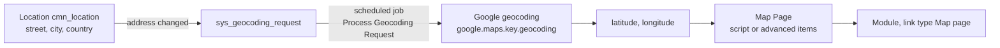

# Map Pages and Google Maps

**In one line:** a **Map Page** shows records as markers on a Google map, from a script or (advanced) from data items, coordinate definitions, markers and filters; coordinates come from **Locations** (`cmn_location`) geocoded through Google with your own API key.

From the Brazil docs; not tested. Map pages are subject to non-production access limits. Table name for map pages not given on these pages (`cmn_map_page`, general knowledge). Newer map experiences: [[Unified Map Administration Settings]].

## Flow

**At a glance:** a location's address change creates a geocoding request; a scheduled job asks Google for latitude and longitude; a map page reads records with coordinates and draws markers.



## Locations and coordinates

- **User Administration > Locations:** Latitude and Longitude filled by business rule **get_lat_long** (deactivate it to keep manual values); optional Company, Full name (calculated parent path), Stockroom.
- Geocoding through the `GoogleMapsHelper` script include, `sys_geocoding_request` records and the scheduled job **Process Geocoding Request** (must be active).
- Periodic refresh: `google.maps.refresh.latlong.duration`, `google.maps.refresh.latlong.record_count_per_table`, tables listed in `cmn_coordinate_refresh_config` with a `coordinates_retrieved_on` field.

## Google Maps properties (System Properties > Google Maps)

Use **your own Google Maps JavaScript API key** in `google.maps.key` (and `google.maps.key.geocoding` for geocoding). **Client ID authentication (`google.maps.client`, `google.maps.client.key`, chosen by `google.maps.method`) stops working from May 2026** per Google. Others: `google.maps.map_id` (cloud styling, advanced markers), `google.maps.version`, `google.maps.latitude` / `longitude` / `zoom` (start view), `google.maps.max_items`, `google.maps.table` (needs name, latitude, longitude), `google.maps.auto_close`; a region property uses the user's Country code. Never record real keys in the vault.

## Map pages

- **System Map Page > Map Pages:** name, starting position, Type selection (Google icon set), **Script**; the base system includes *Critical Incidents*.
- **Script:** `map.addItem(glideRecord)` returns an item with attributes `name`, `latitude`, `longitude` (not needed with an address), `icon`, `icon_width` / `icon_height` (32), `table_name` + `sys_id` (record opened on click), `view`, `html` (custom pop-up), `marker_label`, `label_offset_left` / `_top`; `isMobile` for smartphone tweaks. The docs sample declares `now_GR` but uses `gr` (docs slip).
- **Advanced Map Page** (no scripting, no mobile): Map Data Item (Table, Condition type, Conditions), Map Coordinate Definition (Table, Latitude field, Longitude field), Map Page Marker (data item + coordinate definition), Marker Icon (Level, scripted condition), Marker Click Action (Action type, Title), Map Page Filter Item.
- **Module:** link type **Map page** (or URL `map_page.do?sysparm_name=<map page name>`), with roles; smartphone modules too. **Map application scope** controls which application may change the configuration.

```javascript
// Map Page Script (server, global): active priority 1 incidents at their location
var inc = new GlideRecord('incident');
inc.addQuery('priority', '1');
inc.addActiveQuery();
inc.query();
while (inc.next()) {
    var item = map.addItem(inc);
    item.latitude = inc.location.latitude;
    item.longitude = inc.location.longitude;
    item.icon_width = '16';
    item.icon_height = '16';
}
```

## Example

Map page *Example Open Changes by Site* (advanced): data item on `change_request` where active is true, coordinate definition dot-walking `location.latitude` and `location.longitude` (inference that dot-walked fields are accepted), red marker icon for risk High, module *Example Change Map* for role *Example Change Viewer*.

## Related

- [[Unified Map Administration Settings]] · [[Application Menus and Modules]] · [[Core UI Help, Views, Images and Appearance]]
