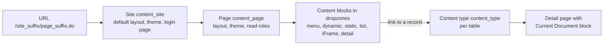

# Content Management System (CMS)

**In one line:** the legacy way to build custom web front ends on the platform (sites of Jelly-rendered pages made of content blocks, such as the old ESS portal at `/ess`); **do not start new work in it**: plugins `com.glide.cms` and `com.glide.cms.extensions` can no longer be activated, and the Brazil docs say CMS is deprecated with support ending in the **C release**. Use [[Service Portal Overview and Configuration]] instead.

From the Brazil docs; not tested. Kept so that instances still running a CMS site can be understood and migrated.

## Flow

**At a glance:** a URL `/<site suffix>/<page suffix>.do` resolves to a site and a page; the page's layout has dropzones holding content blocks; links to records go through the record's **content type** to a detail page.

## Sites and pages

- **Content Management > Sites** (`content_admin` or `admin`): Name, **URL suffix** (case-sensitive; not `portal` or `cms`, which are reserved), Home page (mandatory), Search page, **Login page** (if set, the whole site needs login), Gauge target page, Title, Default layout, Default theme, **Simple catalog display**, **Use external cart** (then add a catalog cart block). Blank site suffix = `cms`; blank page suffix = the page name. The base sample site is **Employee Self-Service** (ESS).
- Site table `content_site` (general knowledge; not named on these pages).
- **Copy** a site duplicates pages, blocks and CSS (not images, which are attachments); copy a page duplicates only the page.
- **Page** (`content_page`): Name (prefix with the site, for example *ESS - Search Results*), URL suffix, Parent page (sorting, breadcrumbs), Layout, Content theme, Frame buster, Content site, **Read roles**, Model document, Page status (Draft, Published), Title. **Edit Page** > Add Content to drop blocks. Pages are not captured in update sets automatically: right-click > **Unload Portal Page**.
- **Security:** with no read role and no site login page, any internet user can open the page. SSO: CMS pages are public by default, so set the public page `view_content` inactive in `sys_public`; for email deep links use a private redirect UI page (or `saml_redirector.do?sysparm_uri=...` with SAML). Login rules are deprecated in favour of the site login page.
- **Domain separation:** the page says CMS supports it, then lists support level **No support** (matches [[Domain Separation Support Levels by Application]]). Treat as not domain-separated.

## Content types and blocks

- **Content type** (`content_type`, per table; site overrides in the site's Content Types related list): how a link to a record looks, how its detail renders, and which detail page shows it. Base types for `sc_cat_item`, `sys_gauge`, `content_page`; a **DEFAULT** type should point to a page with a Current Document block.
- **Blocks** (Content Management > Blocks): Headers, **Navigation Menus** (sections and items with roles; link target current window, named iFrame or new window; list, tab, horizontal and vertical block menus, super menu), **Dynamic** (`content_block_programmatic`, Jelly; *Two phase* for `g2`/`j2` tags; **not automatically escaped, so XSS risk**), **Static HTML**, **Lists** (list definitions are Jelly UI macros; external links in `content_link`), **iFrames** (Frame name, URL such as `sc_req_item_list.do?sysparm_query=active=true`; some browsers block by X-Frame-Options; no reports inside iFrames), detail blocks, Flash movies (obsolete), catalog cart (with `glide.sc.use_cart_layouts`), Live Feed. Tag form: `<g:content_block type="<type>" id="<sys_id>"/>`.
- **Style:** Style Sheets (internal CSS or an external URL), **Themes** (groups of style sheets, Design > Themes), layouts (table- or DIV-based; example theme *Administration Theme - Charcoal*), Frames (decorative containers), doctype via `glide.html.doctype.pages`. Content area at least 860 px or catalog forms clip.
- **Meta tags:** page level and site level, in a hierarchy.
- **Global search:** *Search Results (Global)* for users with global text search roles, *Search Results (No Global)* (knowledge and catalog only) for others.
- **Translation:** shared strings in `sys_translated`, unique ones in `sys_translated_text`; I18N plugins translate menus, breadcrumbs and links.

## Planning advice in the docs

Build CMS after phase 1 processes have mature data; plan content, team (webmaster with HTML, CSS, design), style guide, prototypes, navigation, and test continuously across browsers, links, search, security and accessibility. Equally valid for a Service Portal project.

## Example

An instance still serving *Example ESS* at `/example_ess/`: list its pages in `content_page` where Content site is *Example ESS*, note each page's blocks and read roles, and map them to Service Portal pages and widgets before CMS support ends.

## Related

- [[Service Portal Overview and Configuration]] · [[Service Portal Pages, Containers and Page Route Maps]] · [[Adoption Services, Boards and Legacy UI Tools]] · [[Domain Separation Support Levels by Application]]
