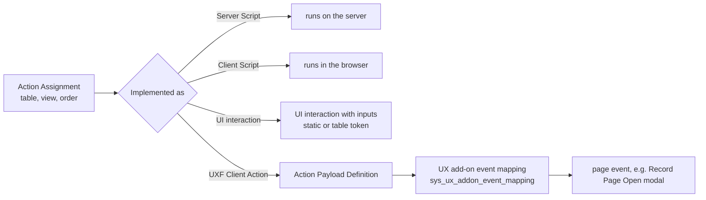

# Declarative Actions in Workspaces

**In one line:** declarative actions are the workspace equivalent of UI actions: records that put buttons on forms, lists, related lists, attachments, fields and rows of a Configurable Workspace without taking ownership of the UI Builder page.

From the Brazil docs; not tested. Classic buttons: [[UI Actions]]. UI interactions and event mapping in UI Builder: [[UI Builder Components, Events and Styling]]. Workspace settings: [[Configurable Workspace Administration - Lists, Forms, Activity Stream and Email]].

## Flow

**At a glance:** an **Action Assignment** (`sys_declarative_action_assignment`) says where the button appears; *Implemented as* says what it runs; a UXF client action needs an **add-on event mapping** to reach the page, while a UI interaction does not.

## Action types

**All > Declarative Actions > Create New Action** (`admin`), then pick the type:

| Type | Notes |
|---|---|
| **Form** | **Enable for all Configurable Experiences** (default false), Tooltip; placed through a form action layout |
| **List**, **Related List** | Icon, **Button type** (colour; *AI Primary/Secondary/Tertiary* gradients mark AI features), **Record Selection Required**, **Experience Restricted** (default false), **Group By** / Group |
| **Attachment** | Workspace, Animate icon |
| **Field decorator** | single-line string fields only; at most three decorators per field; **Decorator applies to** (a field type, etc.) |
| **Row action** | implemented only as a UI interaction |

Common fields: **Action label**, **Action name** (lowercase with underscores, unique), **Implemented as** (Server Script, UXF Client Action, Client Script, UI interaction), Application, **Table** (*Global* = every table), **View** (empty = any view), Active, Order, Description. Icon `ai-sparkle-fill` gives the Otto icon (with **Animate icon** for hover). Admin modules: Declarative Actions > Form Actions, List Actions, Related List Actions, Field Decorators, UX Form Action Layout Groups.

## Implementations

- **UI interaction** (form, list and related list only; roles `ui_interaction_admin` full, `ui_interaction_developer` no delete): pick it in *UI interaction*, then **Configure inputs** with static values or `{{...}}` values from **Action Model Definition** (`sys_declarative_action_model_definition`), for example `{{table}}`. Simpler than a UXF client action because no add-on event mapping is needed.
- **UXF Client Action:** **Specify client action** points to an **Action Payload Definition** whose Payload is sent as an event; a **UX add-on event mapping** (`sys_ux_addon_event_mapping`: Source element ID such as `ui_action_bar`, Source Declarative Action, Parent Macroponent, Target Event, Target Payload Mapping) delivers it to the page.
- **Server Script** / **Client Script:** scripts on the record.

## Placing and grouping form actions

- **UX Form Actions Layout** on the page: UI Builder > Form Controller > Configure > Advanced > **Action layout**.
- **Layout items** (`UX Form Actions Layout Item`): Item Type Action or Group, **Overflow** (into the overflow menu), Icon, Color, Order, Active. Setting a layout item inactive hides that action from pages using the layout. Layouts created from Washington DC are unified; older form actions must be associated by hand.
- **Layout groups** (menu or split button): **Upgrade Group** (irreversible) replaces the glide-list *Actions* field with the *Form actions in group* related list, so order, label and icon can change per group without touching the base action or other layouts, and actions from other scopes can be added.

## Open a custom modal from a form action

1. Create the form action (UXF Client Action).
2. Design a page **variant** in UI Builder; bind a component's table to `@context.props.table` and use `api.context.props.sysId` in scripts.
3. Make it a modal: open its `sys_ux_app_route` (Developer > Open variant collection record > UX App Route), set **Parent Macroponent** to the record page's definition sys_id and **Parent Macroponent Composition Element ID** to `modalContainerViewport`. (The docs list *Activate Customer Service Management* as a prerequisite here.)
4. **Add-on event mapping:** Source element ID `ui_action_bar`, Source Declarative Action = the action, macroponent = the record page, Target Event **[Record Page] Open modal**, Target Payload Mapping binding `route`, `size`, `fields` and `params` from the event payload (`EVENT_PAYLOAD_BINDING`).
5. **Payload** of the action's client action: `{"route": "<page action name>", "fields": {"table": "{{table}}", "sysId": "{{sysId}}"}}`.

Per-modal options in the add-on event mapping's Target Payload Mapping (they override the system properties): `"resizableConfig": {"enableResizable": true}` with `customSize` and `"size": {"type": "JSON_LITERAL", "value": "custom"}`; background loading of related list adds: `asyncProperties` in the payload (`enableAsync`, `asyncThreshold` default 100, `relatedListLabelName`) plus its binding in the mapping.

## Conditions and visibility

- **Dynamic conditions** (list and related list): tick Record Selection Required and Experience Restricted, then **Enable Dynamic Evaluation** with a **Dynamic Script Condition** or **Dynamic Record Conditions**; the button shows only when the selected rows qualify (slow with Select All).
- **Action Exclusions** related list on a global form or list action: Table (with **Exclude this table** and/or **Exclude all child tables**) and/or View; table and view together exclude only that combination.
- **Experience Restricted** list actions show nowhere until a page asks for them: create a **UX Actions Configuration** on the action (Action Configurations list), copy its sys_id, and paste it into the Record List Header's **Action configurations for declarative actions** property on that page.
- **Watch list** field decorators (*Add current user*, *Remove current user*, *Add multiple users*, *Add multiple records*): add the workspace's action configuration to each one's Action Configurations.

## Example

List action *Example Bulk Close* on `incident` (type List, Record Selection Required, Experience Restricted), implemented as UI interaction *Example Close Records* with input `table` = `{{table}}`, a dynamic condition `state != 7`, and an action configuration *Example Agent Lists* whose sys_id is set on the *Example Incidents* list page of *Example Agent Workspace*.

## Related

- [[UI Actions]] · [[UI Builder Components, Events and Styling]] · [[Entity View Action Mapper (EVAM)]] · [[Migrating from ITSM Agent Workspace to Service Operations Workspace]] · [[Configurable Workspace Administration - Lists, Forms, Activity Stream and Email]]
