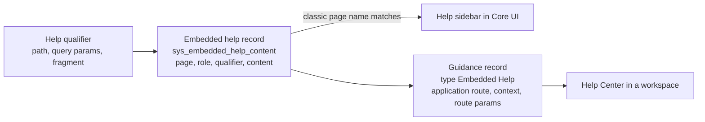

# Guided Tours, Embedded Help and Help Center

**In one line:** **Adoption Services** puts help inside the product: **Embedded Help** (classic pages, `sys_embedded_help_content`), **Help Center** (workspaces; shows embedded help records through **guidance** records), **onboarding modals**, **Guided Tours** (step callouts built in the Guided Tour Designer), the AI voice assistant **Dynamic Guidance**, and the fading **Guided Setup**.

From the Brazil docs; not tested. Map of the smaller UI tools: [[Adoption Services, Boards and Legacy UI Tools]]. Tables (`sys_embedded_help_qualifier`, `sys_embedded_tour_guide`) per [[Metadata File Types and Primary Tables]].

## Flow

**At a glance:** one embedded help record can serve both UIs: on a classic page it is matched by page name, role and qualifier; in a workspace a guidance record (type Embedded Help) points to it by application route, context and route parameters.

## Embedded Help (classic pages)

- Plugin `com.glide.embedded_help`, active by default; Core UI only (workspaces use Help Center). Help icon shows an indicator when content exists; otherwise links to the user guide and docs search. Admin role `embedded_help_admin`.
- **Record fields:** Name, **Page** (UI page name from the URL, without `.do`; keep a leading `$`), **Modifier** (Normal, or Setup when opened from Guided Setup), **Qualifier**, **Role** (lowest role; containing roles see it unless they have their own topic), Product Enterprise, Version (All for custom content), Domain, **ServiceNow Help** (base topic, read-only: use **Copy**), Content (no images, which are stripped; full URLs only; videos only as YouTube/Vimeo iframe source inside `
`).
- **Qualifiers** (Embedded Help > Help Qualifiers) target shared pages like `home.do`: Path (`home`), Query params (`id=sla_homepage`; use underscores, a hyphen cuts the value), Fragment; `$dynamic_value$` supported.
- **Role priority** (`sys_embedded_help_role`, Embedded Help > Role Priority): 10 admin-type roles, 100 manager-type and `itil_admin`, 300 `itil`, 1000 others or no role; lowest number wins.
- **Sync:** base content comes from a ServiceNow CDN; a viewed page older than the sync period queues a request in `sys_embedded_help_queue` (refresh after about a minute). Properties: `com.glide.embedded_help.sync`, `.sync_frequency` (15 days), `.cdn_timeout` (2000 ms), `.enable_video`, `.auto_close`, `.url`, `.version` (default printed as *Jakarta*; blank = running version), `.sync_self_hosted` (false), `.guided_setup.persist_actions`.
- **Not in update sets** (`update_sync=false` on purpose): move custom help another way.
- **Languages:** write in a session of that language; the English record is the parent, translations go to `sys_translated_text`; session language beats role, custom and version; a property (name not given) can stop English fallback.
- **Domain separation:** Basic; content without a domain is global and shown when no domain content exists.

## Help Center (workspaces)

Active by default; detachable, draggable panel; several topics per page; thumbs up/down feedback (Usage Insights events); **What's New** tab per application and role; *Provide feedback* off with `glide.ui.product_feedback_enabled` = false. AI Search inside the App Engine Studio help panel.

**Add content:** create or copy an embedded help record (Name and Page the same), then from the workspace page **Add New Content** opens a **Guidance** form: Name, Type **Embedded Help**, Roles (only matching roles see it), **Application route** (`now/sow`), **Context** (word after the route, such as `home`, `list`, `record`; `sn_all` for every page), **Route parameters** (`{"params":{"listId":"<list sys_id>"}}` or `{"params":{"table":"problem"}}`, also for `sub/record/<table>`), Status **Published**, Active.

## Onboarding modals

**Adoption Services > Create Guidance** with Type **Modal** (Order, Name, Roles, Application, Status, Active); steps in **Help Guidance Steps** (layouts Video, Image, Text, Question, Image and Text, Image and Question; Action Label) with **Contents** per step. Launch from a UI Builder client script `api.emit('SN_HELP#GUIDANCE_START_REQUESTED', {guidanceId: '<sys_id>'})` and declare that dispatched event on the page body. Turn all modals off without touching the help panel: `com.glide.sn_help.modal.enabled` = false. Images follow the light, dark or Coral theme.

## Guided Tours

- Roles: `guided_tour_admin` (designer), plus `embedded_help_admin` for auto-launch. **Guided Tour Designer > Create Tour**: name, type (Standard UI, Workspace, Service Portal with a portal record, Custom UI), starting page (or pasted workspace URL; custom pages listed in `com.snc.guided_tours.homepages`), roles (All or Specific).
- **Steps:** drag a callout onto an element, text, **trigger** (Next button, click, hover, right-click, Enter, value change, any key, drop-down selection, double-click), **Skippable**; one interaction per step; optional view on one step (only if it starts in the default view). Preview, Play, Exit (auto-saved). Edit settings on the Guided Tours form (Status draft/published, Roles, Active, Additional URL Parameters for portal tours).
- **Enable:** `com.snc.guided_tours.standard_ui.enable`, `com.snc.guided_tours.sp.enable`, `com.snc.guided_tours.custom_ui.enable`; `com.snc.guided_tours.sort` sorts the Help Center list. The designer itself runs only in Core UI.
- **Auto-launch** (Guided Tour Designer > Configure Auto Launch): per starting page, several tours in order; only published tours launch; only for logged-in users; reset per user with *Override tour Auto Launch Preferences*.
- **Users** start tours from the Help Center (four shown, then Show more) or the portal header Tours menu; the **Guided Tours Overview** dashboard shows usage and failures.
- **Limits:** no portal pages with iframes or the Branding Editor, no empty or custom-to-Polaris app shells, no callouts inside workspace iframes, no tours crossing from classic or workspace into a portal, no continuation into a new tab, no mobile view.
- **Next Experience disagreement:** the limitations page lists "tours when loaded in the Next Experience UI" as unsupported, the enable page says tours are supported on Next Experience pages (with `com.snc.guided_tours.standard_ui.enable` = true), and the Next Experience Readiness Checker flags Guided Tours as incompatible ([[Next Experience UI and Unified Navigation]]). All kept; a test settles it.

## Dynamic Guidance

AI voice and screen-share assistant (Google Gemini Live) started from Help Center or the Otto panel skill *Ask Dynamic Guidance for help*; answers from ServiceNow docs of the instance's release family through **External Content Connectors** (XCC) and AI Search, extendable with custom sources in a search profile. Roles: admins `sn_dyn_guidance_admin` and `sn_nowassist_admin.nsa_admin` activate the skill (Otto Admin > Platform > Other); users need `sn_dyn_guidance_user` (includes `genai_admin`, which grants no admin rights); Google must be allowed in AI Control Tower. Limits: English, US and EU regions only, no highlighting, no actions for the user, Core UI and workspaces only (not Service Portal), 30 minutes per session, no screen share in Safari; transcripts are stored, voice and screen are not. Minimum Zurich patch 8 / Australia patch 1. See [[AI Agent Studio, Agentic Workflows and AI Control Tower]].

## Guided Setup

Categories of setup activities (including *Plugin Install*) for a product; roles `sn_help_setup_admin`, `sn_help_setup_player`; created in the global domain only. **Being prepared for future deprecation since Australia** (hidden on new instances, still supported).

## Example

Embedded help *Example Incident Intake* for page `incident`, role `itil`, Modifier Normal, Version All; guidance *Example Incident Intake* (Embedded Help, route `now/sow`, context `record`, route parameters `{"params":{"table":"incident"}}`, Published); Guided Tour *Example Create Delegate* on `sys_user_delegate_list.do` with auto-launch on.

## Related

- [[Adoption Services, Boards and Legacy UI Tools]] · [[Core UI Help, Views, Images and Appearance]] · [[Next Experience UI and Unified Navigation]] · [[UI Builder Components, Events and Styling]] · [[Usage Insights]]
