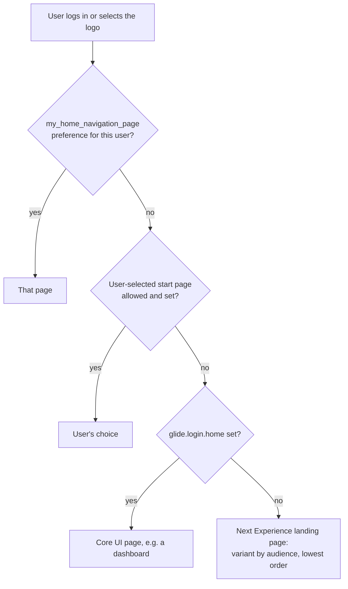

# Next Experience Landing Pages and Start Pages

**In one line:** the page a user lands on at login (or by selecting the logo) is decided, from most to least specific, by the user preference `my_home_navigation_page`, a user-selected start page if allowed, the property `glide.login.home`, and otherwise the **Next Experience landing page** variants of the *Unified Navigation App* experience in UI Builder.

From the Brazil docs; not tested. The precedence below is pieced together from separate pages (inference where marked). Workspace landing pages are configured per workspace instead: [[Service Operations Workspace Access and Landing Page]].

## Flow

**At a glance:** preference beats property; a property or preference beats the default landing page; landing page variants are chosen by audience and order.

Where the user-selected start page sits relative to the preference and property is not stated (inference). The docs also say an administrator can set a start page that users cannot override.

## Start page options

| Option | Notes |
|---|---|
| Next Experience default landing page | variants for admins and non-admins |
| Configurable workspace home | any workspace page |
| User-selected landing page | any page, including a workspace page |
| Admin-selected landing page | a workspace page or a classic dashboard, with role-based logic possible |
| Responsive dashboards | classic dashboards not available in a workspace |
| Homepages | deprecated; read-only since Tokyo and turned off by default in Next Experience; convert to responsive dashboards before upgrading |

Any page can also have redirect rules while loading. New (or zBooted) instances get the Next Experience landing page; upgraded instances keep their homepage or dashboard start page.

## Settings

| Goal | How |
|---|---|
| Custom landing page for an audience | UI Builder > **Unified Navigation App** > Home > *Next Experience Landing Page* (non-admin default, **order 1000**) or *Next Experience Landing Page - Admin Role* (**order 99**) > **Duplicate variant**, set Audiences and optional Conditions (encoded query), customize, then in Settings give it a **lower** order (lower = higher priority). Roles `ui_builder_admin` or `admin`. Not for workspace landing pages |
| Per-user page | **User Administration > User Preferences**: Name `my_home_navigation_page`, User, Value = the URL part (for example `$vtb.do`; decode `%24` to `$`). Without a user it applies to everyone and overrides `glide.login.home` |
| Instance-wide Core UI page | `glide.login.home`, for example `$pa_dashboard.do` plus the rest of a dashboard URL; seen after logging out and in |
| Let users choose | `glide.next_experience.user_selected_landing_page_enabled` = true (create it if missing); users: Preferences > **User Experience** > **Current start page**: Use the default, Use Dashboards, Use the page that I'm on now, Continue where I last left off; sign out and in |
| Landing page footer | duplicate the admin landing page variant, Client State Parameters > clear **hideResourcesSection**; edit the two Link set components (default *Frequent visits* and *Learn more*) |

The **default admin landing page** shows apps with updates available, entitled but not installed apps, security notifications, the admin's assignments and learning resources.

## Example

Duplicate *Next Experience Landing Page* as *Example Service Desk Home*, audience *Example Service Desk Agents*, order 500; for *Test User* only, add preference `my_home_navigation_page` = `$vtb.do`.

## Related

- [[Next Experience UI and Unified Navigation]] · [[Next Experience Themes and Theme Builder]] · [[UI Builder Pages, Variants and Layouts]] · [[Adoption Services, Boards and Legacy UI Tools]]
