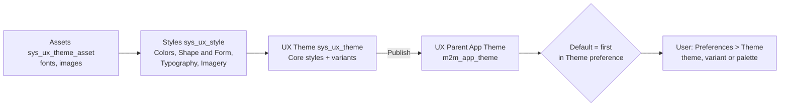

# Next Experience Themes and Theme Builder

**In one line:** a Next Experience theme is a **UX Theme** record (`sys_ux_theme`) made of JSON **style** records (`sys_ux_style`: colors, shape and form, typography, imagery); **Theme Builder** edits them visually and publishes them, and published themes are listed per parent app in `m2m_app_theme`, where users pick one in Preferences > Theme.

From the Brazil docs; not tested. Overview of the UI: [[Next Experience UI and Unified Navigation]]. Theme in UI Builder experiences: [[UI Builder Components, Events and Styling]]. Service Portal themes are a different mechanism: [[Service Portal Portal Record, Branding and Themes]].

## Flow

**At a glance:** build styles (in Theme Builder or as JSON records), attach them to a theme record, publish it into **UX Parent App Theme** (`m2m_app_theme`), mark one default; each user then picks a theme and variant in Preferences.

## Shipped themes

- **Polaris** and **Coral**, both read-only, each with a **Dark** variant (the only variant shipped). Coral is the default on new instances from Zurich; upgraded instances keep what they had (for example Polaris).
- Default font: the configuring-themes page says **Lato**; Theme Builder pages say a deleted custom font falls back to **Source Sans Pro** (Regular). Both kept; which applies to which theme is unconfirmed.

## Theme Builder

**All > Now Experience Framework > Theme Builder**, role `ui_builder_admin` (granular admin roles also mentioned). Store application `sn_theme_builder` per [[Service Operations Workspace Access and Landing Page]]. Page views: **Home**, **Editor**, **Manager**.

| Area | What it holds |
|---|---|
| Create | name, brand colours (primary, secondary, neutral), logo; or **AI theme creation** from an image or brand-guideline PDF |
| Global styles | Colors (with contrast ratio in the picker; *additional brand colors* tie to no component by default), Shapes, Typography (default font family, fonts by component category, sizes; *Remove override* reverts), Logo / Imagery |
| Component styles | per-component overrides |
| Image styles | recolour illustrations or replace them with your own |
| Manager | Published / Unpublished sections, list or grid view; actions **Publish**, **Unpublish**, **Mark as default**, **Add alternate color palette** |
| Accessibility Inspector | checks text and background contrast |

- **Core styles, variants, alternate color palettes:** core styles are the base theme; a **variant** (for example Dark) is an alternate version users choose; an **alternate color palette** starts as a copy of the theme with only its name different and is based on a light or dark palette. In a dark palette only the primary colour can be edited (secondary and neutral cannot). Not available on Polaris or Coral.
- **Custom fonts:** up to 10 families, unlimited faces; one family per upload; WOFF, TTF or ZIP under 2 MB (faces: WOFF or TTF); no variable fonts; only licensed fonts. Deleting the last face deletes the family; components using a deleted family fall back to Source Sans Pro, using a deleted face fall back to the family's first face.
- **Logo:** at most 400 x 50 px, under 120 KB, SVG, PNG or JPG; removing it restores the ServiceNow logo. Login logo height: create `glide.ui.polaris.login.logo.height` (CSS height such as `150px`, `6em`, `75%`, `auto`; `100%` = original size).
- **AI theme creation:** needs **Otto for Creator** ([[Otto for Creator and Otto for App Engine]]). From the Otto panel it also needs the **Theme Creation Workflow** turned on in AI Agent Studio and the panel active ([[AI Agents Library - Platform and Creator Agents]]). Image size limit: **20 MB** from the Otto panel vs **1 MB** inside Theme Builder (both pages; PDF 20 MB in both). Recorded as a variant.
- **Publish:** web instances can have several published themes; **mobile** only one at a time (per-app mobile themes through Mobile App Builder). Check the application scope picker before publishing or marking default. Themes built outside Theme Builder (Core UI, legacy mobile) cannot be edited or published in it. Users must then select the theme in their Theme preference; refresh the browser.
- **Default and order:** with one published theme it is the default. The default is first in the Theme preference and shown to users who chose nothing; drag in the Manager list view to order the rest. If the default is deleted or moved, the next theme becomes default.
- **Domain separation:** *No support*.

## Theme records by hand (UX Themes)

Role `admin`. Usually you work with the **Compositional Theme**; experiences without a parent app, or with an app shell other than Breadcrumb or Agent Workspace, are themed through UI Builder instead.

- **Style record** (`sys_ux_style.do`): Name, Type **Core** or **Variant**, **Style** JSON with `base` (RGB brand colours; the theme generates 20+ shades) and `properties` (shades, shapes, typefaces), Application. Invalid JSON blocks saving on a Theme Builder theme. The docs point to an external colour generator page to produce the JSON.
- **Theme record:** **Compositional: App Theme** related list rows with **Applicability** (audience; empty = everyone), **Order** (higher wins; a custom style must outrank the Polaris or Coral one), **Style**, **Type** (Core or Variant).
- **Clone a Theme Builder theme:** it must be published; clone its five style records (Mobile Colors, Shape and Form, Colors, Imagery, Typography) with *Insert and Stay*, clone the theme record, attach the new styles as Core. The clone is not editable in Theme Builder.
- **Assets** (`sys_ux_theme_asset_list.do`): attach fonts (one file per weight or style) or SVG images; optional Asset Properties script. Default themes cannot take assets.
- **Instance banner logo:** **UI16 Banner Image** (system properties); scaled to at most 20 px high; restore with `glide.product.image.light` = `now-next-experience-logo.svg`; clear cache (`cache.do`) and log in again if it does not show.
- **Override the default theme (old way):** create `glide.ui.polaris.theme.custom` (string, theme sys_id; a **Suffix** is required to target an application scope). From Xanadu it is read **only when `m2m_app_theme` is empty**; with both empty the Unified Navigation base theme shows.
- **Multi-theme** (`m2m_app_theme`, *UX Parent App Theme*): Applicability, Theme, **Order** (lowest applicable = default, first in the preference), Application, **UX App**. Web only. Theme Builder adds its themes automatically on publish.

Two order rules, not to be confused: style **Order** on a theme, higher wins; theme **Order** in `m2m_app_theme`, lowest is default.

## Dark theme

Supported for configurable workspaces, lists, forms, dashboards and reports; custom pages may not inherit it. Variants do not apply to Core UI.

| Goal | Properties |
|---|---|
| Dark theme in workspaces and limited classic | `glide.ui.polaris.dark_themes_enabled` = true |
| Off everywhere | `glide.ui.polaris.dark_themes_enabled` = false |
| Workspaces only | `dark_themes_enabled` = true and `glide.ui.polaris.core_ui_exclude_dark_mode` = true |

## Empty state images

12 theme-able empty state image types (small, medium, large), adapting to theme colours; insert with the **Illustration** component (or **Custom Illustration**) in UI Builder. Customize through the theme's **Imagery** style record using theme hooks; custom SVG images go in `db_image` and are referenced as `/uxta/<asset sys_id>.assetx`. Workspaces only, not Core UI. A Theme Builder theme gets an empty UX Styles Imagery record. Hide the Core UI no-records graphic: `glide.ui.polaris.style.hide_empty_list_image`.

## Login page

Not for SSO logins.

| Setting | How |
|---|---|
| No illustrations (also removes the gradient, giving the default theme's solid colour) | `glide.ui.polaris.login.show_illustrations` = false (typed *string* in the properties list) |
| Welcome text | create `glide.ui.polaris.login.show_welcome` = true; **System UI > Welcome Page Content** record with Condition `!gs.getSession().isLoggedIn()`, Text, Active |
| Background image | upload to Images (`db_image`), create `glide.ui.login.style.background.image` = file name (string, Ignore cache); wins over a colour |
| Background colour | create `glide.ui.polaris.login.style.background` = `R, G, B`; the login modal keeps the **default** theme's colours |
| Gradient and mountain colours | `glide.ui.polaris.login.style.background_gradient_begin` / `_end`, `...mountain_primary` / `_secondary` |

## Preserve a theme during clone

Clone data preserver (Theme ticked) on `sys_properties` where Name is `glide.ui.polaris.theme.custom`, plus preservers with no condition for `sys_ux_theme`, `sys_ux_style`, `m2m_theme_style`, `m2m_style_asset`, `sys_ux_theme_asset`, `sys_ux_theme_m2m_asset`, `sys_ux_theme_customization`, `m2m_app_theme`, and with conditions for `sys_properties` (`glide.ui.polaris.theme_builder.override_logo`), `sys_user_preference` (`glide.ui.polaris.theme`, `glide.ui.polaris.theme.variant`) and `sys_attachment` (custom logos). An unpublished theme must be published again on the target. See [[Instance Clone Overview]].

## Example

In Theme Builder create *Example Brand Theme* with three brand colours and an SVG logo, add custom font family *Example Sans* (WOFF), add a dark alternate color palette *Example Brand Dark*, publish it and **Mark as default**; *Test User* then sees it first in Preferences > Theme.

## Related

- [[Next Experience UI and Unified Navigation]] · [[Next Experience Landing Pages and Start Pages]] · [[UI Builder Components, Events and Styling]] · [[Workspace Builder]] · [[Platform Analytics Data Visualizations]]
