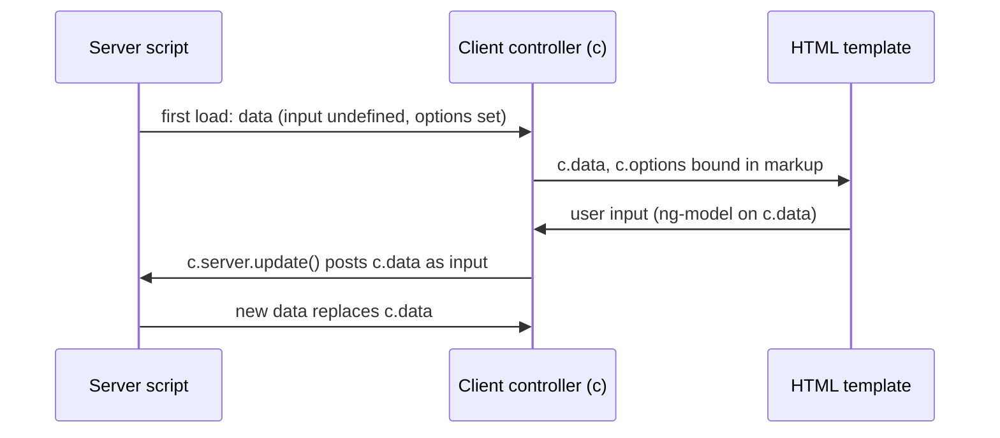

# Service Portal Widget Development

**In one line:** how a custom widget's server script, client controller and template exchange data, and how to configure, reuse, embed and translate widgets without overloading them.

From the Brazil docs; not tested. Parts and APIs at overview level: [[Service Portal Widgets]]. Pages, portals and tables: [[Service Portal Overview and Configuration]]. Debugging: [[Service Portal Widget Misbehaves or Loads Slowly]]. Roles for every task here: `admin` or `sp_admin`.

## Flow

**At a glance:** the server script runs first and fills `data`; the client reads it as `c.data`; `server.update()` posts `c.data` back as `input`, reruns the server script, and overwrites the client's `data`.



## Parts of a widget

| Part | Mandatory | Use |
|---|---|---|
| HTML template | yes | AngularJS view, binds controller variables, gathers input |
| Client script | yes | AngularJS controller: maps server data, posts input back |
| Server script | yes | initial state, queries, fills `data` |
| Link function | no | direct DOM manipulation |
| Option schema | no | parameters an admin sets per instance |
| Angular Providers | no | shared state and behaviour injected into several widgets |
| Dependencies | no | external JavaScript, CSS or Angular modules |

The record is in **Widget** (`sp_widget`); the **Widget Editor** (Service Portal Configuration) edits it like an IDE, with a live preview. Server scripts can use the ECMAScript 2021 (ES12) mode.

## Global objects

**Server script** (server, the widget's application scope):

- `data`: starts empty; whatever the script sets is sent to the client as JSON.
- `input`: what the client posted under `c.data`; **undefined** on first load, so guard for it (the tutorial tests `input.keywords != null`).
- `options`: the instance options (read-only on the client as `c.options`).

**Client controller** (client): `c` is the controller (`controller as` syntax; the name can be changed when creating or cloning). Functions on the controller's `server` object, each returning a promise:

| Call | Does |
|---|---|
| `c.server.get(obj)` | sends a custom `input` without posting `c.data`; pair with `input.action` to run one part of the server script |
| `c.server.update()` | posts `c.data` as `input`; afterwards the client `data` is **overwritten** by the server's |
| `c.server.refresh()` | reruns the server script and replaces both `options` and `data` |

The global `g_form` cannot be used in a widget client controller or a UI script (docs, Widget API reference). On a catalog form, an embedded widget reaches the form through `$scope.page.g_form` (below).

## General guidelines (Brazil docs)

- **Default state:** a new instance has no options; show what needs configuring, or demo data (shown in the Widget Editor preview, not in the Designer).
- **Embed rather than clone** when you only need to pass parameters. A cloned base widget is custom and no longer gets upgrades.
- **Directive instead of an embedded widget** for a lightweight shared piece (a list, an avatar): embedding returns all the embedded widget's scripts.
- **Keep data small:** filter and limit queries (`gr.setLimit(options.limit || 100)`), avoid scripted menu items that load a lot (they slow every page), large theme fonts or media, auto-refreshing widgets, and unfiltered `spUtil.recordWatch()`. Every `server.update()`, `spUtil.update()`, `server.refresh()` or `spUtil.refresh()` reruns the server script. Isolate heavy widgets on their own page.
- **Share state** through a service or factory (Angular Provider); **events** through a publish/subscribe service rather than `$broadcast` on `$rootScope`.
- **Later data calls:** set up the initial state in the server script, then use scripted REST APIs that call script includes (or `server.get` with `input.action`), because `server.update()` returns the whole widget.
- Mobile first (no mouse-over), SCSS variables and named colours, translated strings, remove unused injected providers, and no inline `<script>` templates: create an **Angular ng-template** (`sp_ng_template`) record instead.

## Option schema and instance options

Two places to keep options:

| Where | Field types | Stored in |
|---|---|---|
| **Option schema** (Widget Editor menu > *Edit option schema*) | String, Boolean, Integer, Reference, Choice, Field_list and Field_name (depend on a table), Glide_list | schema in **Option schema** of `sp_widget`; each instance's values as JSON in **Additional options, JSON format** of `sp_instance` |
| **Extension table** of **Instance** (`sp_instance`) or **Instance with Table** (`sp_instance_table`, adds Table and Filter) | any field type, searchable and filterable | the extension table; set it as the widget's **Data table**, then pick fields in the widget's **Fields** slushbucket and on the table's form layout |

Prefer the schema; a table is harder to maintain and adds server calls. Each schema option has label, name, type, hint and form section (default *Other options*). Read an option as `options.name` (server) or `c.options.name` (client). An unset option is `undefined`, so set defaults in the server script:

```javascript
// Widget server script (server, widget scope)
(function() {
    options.example_color = options.example_color || 'blue';
    options.example_max_items = options.example_max_items || 5;
})();
```

## Angular Providers

Records in **Widget Angular Provider** (`sp_angular_provider`), types **Directive**, **Factory** or **Service** (docs advise services over factories, for a later move to ECMAScript 6). Link one to a widget through the widget's **Angular Providers** related list, then inject it by name into the controller; a directive is used in the template instead. The Widget Editor opens linked providers from *Show > Dependencies*, and saves widget and provider together. Register the provider on every widget that uses it.

```javascript
// Angular Provider, type Factory, name exampleFormatter (client)
function exampleFormatter() {
    return { format: function(value) { return '$' + value.toFixed(2); } };
}
// Widget client controller (client)
function(exampleFormatter) {
    var c = this;
    c.price = exampleFormatter.format(300);
}
```

Removing the default providers from a base widget breaks it (for example `scToggleData` or `scBindHtmlCompile` from *SC Catalog Item*).

## Embedded and nested widgets

| From | How | Placed with |
|---|---|---|
| HTML template | `<widget id="example-widget" options='{"title": "Example"}'></widget>`, or `options='data.exampleOptions'` set in the server script | itself |
| Client script | inject `spUtil`; `spUtil.get('example-widget', {sys_id: c.data.sys_id}).then(function(r) { c.child = r; })` | `<sp-widget widget="c.child"></sp-widget>` |
| Server script | `data.child = $sp.getWidget('example-widget', {title: 'Example'})` | `<sp-widget widget="data.child"></sp-widget>` |

The returned **widget model** holds `template`, `client_script`, `css` (compiled SCSS), `data` (result of its server script), `options` and `dependencies`. The docs' pattern for one widget shown several times: build an array of `$sp.getWidget()` models on the server and `ng-repeat` over `<sp-widget>`.

**Variant to check:** the API reference names the first parameter of `$sp.getWidget()` `sysID`, while every embedding example passes the widget **ID** (`widget-cool-clock`, `widget-sc-cat-item`). Both are recorded; a test will settle whether a sys_id also works.

The team notes call this **nested widgets** and link an old San Diego page; the Brazil docs name it *Embedded widgets* (same mechanism, inference from the matching link).

## Dependencies

A **dependency package** (Service Portal > Dependencies, `sp_dependency`) holds **JS Includes** (a URL or a UI script) and **CSS Includes** (a URL or a style sheet in `sp_css`). Fields: Name, Application, **Include on page load** (load with the portal rather than only when the widget loads), **Angular module name** (when the JavaScript is an Angular module to inject). Link it through the widget's **Dependencies** related list. Dependencies load asynchronously; keep them small.

**Font icons:** for one widget, attach the font file to the widget record and point `@font-face` in the widget CSS at `/<attachment_sys_id>.iix` (scoped to the widget). For every widget, put the same CSS in an `sp_css` style sheet and add it as a CSS Include of a dependency; dependency CSS is **not scoped** and can disturb other styles.

## Translation

`${Example text}` in the template or client script, and `gs.getMessage('Example text')` in the server script, look the string up in **Message** (`sys_ui_message`). `${message}` is shorthand for `${gs.getMessage("message")}`. A translation containing quotes can break a client script that uses `${}`: translating in the server script into `data` and binding `{{c.data.message}}` is the safe route; option values can be translated the same way (`gs.getMessage(options.title)`). See [[Languages, Translation Tables and Locale]].

## Widgets on catalog forms

A widget can replace a UI macro on a catalog item: add a variable of type **Macro** and fill its **Widget** field (configure the variable form to show it). Inside the widget, `$scope.page.g_form` is the form's `g_form` (supported methods only), and `$scope.page.field` the variable. Watch a variable:

```javascript
// Widget client controller, embedded in a catalog item through a Macro variable (client)
function($scope) {
    var c = this;
    $scope.$watch(function() {
        return $scope.page.g_form.getValue('example_variable');
    }, function(value) {
        c.data.message = value ? 'Example variable: ' + value : '';
    });
}
```

See [[Catalog Variables and Variable Types]]. From the browser console only, the team notes reach `g_form` through `sp-variable-layout` ([[GlideForm and GlideAjax Client API Reference]]).

## Building one (tutorial outline)

The docs tutorial builds a *Quick Order* widget: Widget Editor > *Create a new widget* with *Create test page* (which creates `sp_page`, `sp_container`, `sp_row`, `sp_column`, `sp_instance` and `sp_widget` records; delete the test page afterwards). Its server script searches **Catalog Item** (`sc_cat_item`) with the `123TEXTQUERY321` keyword query, skips items failing `$sp.canReadRecord()`, and fills results with `$sp.getRecordDisplayValues()`; the template uses `ng-model` with a 250 ms debounce (`ng-model-options`) and `ng-change="c.server.update()"`. It then adds an empty state (popular items when `input` is undefined), embeds *SC Catalog Item* in a modal, and uses an Angular Provider for category icons. Preview at `<instance>.service-now.com/sp?id=<page_id>`.

**Clone** (Widget Editor, widget menu > *Clone*): the ID derives from the name; a widget using an ng-template needs that template cloned and renamed by hand (for example the header menu's `menuTemplate`).

## Example

Create *Example Request Panel* (ID `example-request-panel`) with option *example_max_items* (Integer, default 5 set in the server script). The server script queries `sc_cat_item` with `setLimit(options.example_max_items)`; the client calls `c.server.get({action: 'search', keywords: c.keywords})`; a factory *exampleFormatter* formats prices; the template embeds `example-detail-widget` through `$sp.getWidget()`.

## Related

- [[Service Portal Widgets]] · [[Service Portal Overview and Configuration]] · [[Service Portal Embeddables]] · [[Service Portal Widget Misbehaves or Loads Slowly]] · [[Service Catalog in Employee Center, Service Portal and Mobile]]
