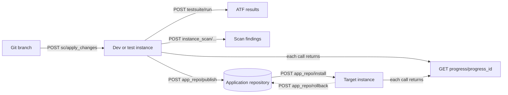

# CICD REST APIs

**In one line:** the `sn_cicd` namespace lets a pipeline (Jenkins, Azure Pipelines, GitLab, GitHub Actions, Bamboo and others) drive an instance: pull from source control, run ATF suites and Instance Scan, publish to and install from the application repository, activate plugins, and move update sets, each call returning a **progress id** to poll.

From the Brazil REST API reference; not tested. Role: `sn_cicd.sys_ci_automation` or `admin`. Plugin `com.glide.continuousdelivery` (named on the Update Set page). Queueing of lock-holding operations since Tokyo, and the **Application Operation Queue**, are in [[Application Repository, Publishing and Administering Apps]].

## Flow



**At a glance:** apply source control changes, test, scan, publish, install elsewhere, and poll every step through `progress/{progress_id}`.

## Asynchronous model

Every action starts work and returns at once with an execution status and `links` (`progress`, `results`, `source`, `findings`, each with a `url`). Poll **GET `/api/sn_cicd/progress/{progress_id}`** until it completes, then follow the results link.

## Endpoints

| Area | Method and path | Notes |
|---|---|---|
| Source control | POST `/sn_cicd/sc/apply_changes` | pull a branch into a linked app (`scope` or `sys_id`, `branch_name`, `auto_upgrade_base_app`) |
| | POST `/sn_cicd/sc/import` | import an app from a repository (`repo_url`, `branch_name`, `credential_sys_id`, `mid_server_sys_id`); the repository must already have been set up from another instance with *Link to source control* |
| | POST `/sn_cicd/sc/apply_stash/{stash_id}` | apply a stash generated earlier |
| ATF | POST `/sn_cicd/testsuite/run` | `test_suite_sys_id` or `test_suite_name`, `browser_name`, `browser_version`, `os_name`, `os_version`, `is_performance_run`, `run_in_cloud`; UI tests need a scheduled Client Test Runner or headless execution |
| | GET `/sn_cicd/testsuite/results/{result_id}` | suite results |
| App repository | POST `/sn_cicd/app_repo/publish` | `scope` or `sys_id`, `version`, `dev_notes`; returns **400** if tracked files have uncommitted changes (commit in Studio or call `sc/apply_changes` first) |
| | POST `/sn_cicd/app_repo/install` | `scope` or `sys_id`, `version`, `auto_upgrade_base_app`, `base_app_version`; the app must be **published first** |
| | POST `/sn_cicd/app_repo/rollback` | to a `version`; only after the install completed |
| Batch install | POST `/sn_cicd/app/batch/install` | `name`, `notes`, `packages[]` (`id`, `type` application or plugin, `requested_version`, `requested_customization_version`, `load_demo_data`, `notes`) |
| | GET `/sn_cicd/app/batch/results/{result_id}`; POST `/sn_cicd/app/batch/rollback/{rollback_id}` | results; roll back the whole batch |
| Plugins | POST `/sn_cicd/plugin/{plugin_id}/activate`, `/rollback` | rollback returns to the previous installed version |
| Instance Scan | POST `/sn_cicd/instance_scan/full_scan` | all active checks |
| | POST `/sn_cicd/instance_scan/point_scan?target_table=&target_sys_id=` | checks against one record |
| | POST `/sn_cicd/instance_scan/suite_scan/{suite_sys_id}/scoped_apps` (`app_scope_sys_ids`) or `/update_sets` (`update_set_sys_ids`) | a suite against apps or update sets |
| | POST `/sn_cicd/instance_scan/suite_scan/combo/{combo_sys_id}`; GET `/sn_cicd/instance_scan/result/{progress_id}` | rerun a suite and target pair; progress ([[Instance Scan]]) |
| Update sets | POST `/api/sn_cicd/update_set/create` | `update_set_name`, `description`, `scope` or `sys_id`; creates a `sys_update_set` record |
| | POST `/api/sn_cicd/update_set/retrieve` | `update_set_id` (on the source), `update_source_id` or `update_source_instance_id` (`sys_update_set_source`), `auto_preview`, `cleanup_retrieved` |
| | POST `/api/sn_cicd/update_set/preview/{remote_update_set_id}` | check for conflicts; retrieve first if it is not on the instance |
| | POST `/api/sn_cicd/update_set/commit/{remote_update_set_id}`, `/commitMultiple` (`remote_update_set_ids`, committed in the order given) | `force_commit` skips sets already committed earlier |
| | POST `/api/sn_cicd/update_set/back_out` | `update_set_id`, `rollback_installs` (also roll back installs done by the commit) |

## Example

Run *Example Test Suite* from a pipeline and poll its progress:

```bash
curl -X POST -u "<CI_USER>:<PASSWORD>" "https://<instance>.service-now.com/api/sn_cicd/testsuite/run?test_suite_name=Example%20Test%20Suite"
curl -u "<CI_USER>:<PASSWORD>" "https://<instance>.service-now.com/api/sn_cicd/progress/<PROGRESS_ID>"
```

Use a dedicated integration user holding only `sn_cicd.sys_ci_automation` ([[Non-Interactive Users]]).

## Related

- [[Application Repository, Publishing and Administering Apps]] · [[ServiceNow Studio Source Control, Fluent Apps and Deployment]] · [[ATF Test Suites, Schedules and Administration]] · [[Instance Scan]] · [[Update Sets]] · [[DevOps Jenkins Integration]] · [[REST API Fundamentals]]
