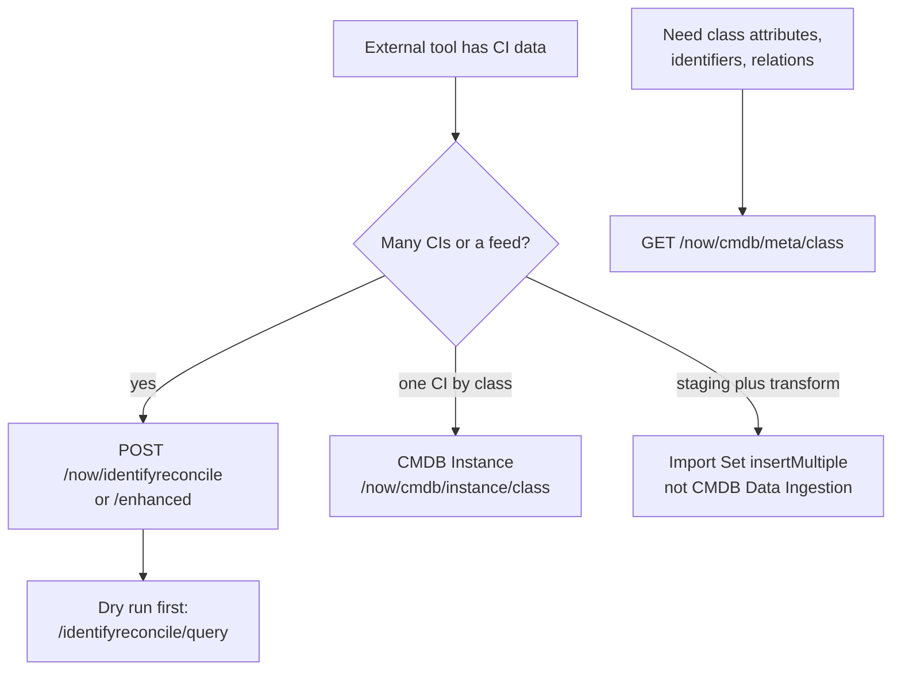

# CMDB REST APIs - Instance, Meta, IRE and Data Ingestion

**In one line:** to write CIs from outside, send them through the **Identification and Reconciliation** API (`/api/now/identifyreconcile`) so the IRE prevents duplicates and respects authorised sources; use **CMDB Instance** for single-CI CRUD and relations by class, **CMDB Meta** to read a class's definition, and avoid the older **CMDB Data Ingestion** API.

From the Brazil REST API reference; not tested. Engine behaviour (identification rules, reconciliation, data source rules) is in [[Identification and Reconciliation Engine (IRE) Overview]] and the IRE notes linked below.

## Which one



**At a glance:** IRE API for feeds, Instance API for one CI at a time, Meta API to discover a class, Import Set API instead of Data Ingestion.

## Identification and Reconciliation (`/api/now/identifyreconcile`)

Roles: `itil` or `asset`.

| Method | Path | What it does |
|---|---|---|
| POST | `/identifyreconcile` | inserts or updates CIs and relations by applying identification and reconciliation rules; use it **instead of writing the CMDB directly** |
| POST | `/identifyreconcile/query` | the same payload as a **dry run**: says insert or update, commits nothing |
| POST | `/identifyreconcile/enhanced` | as the first, with **Enhanced IRE** `options` |
| POST | `/identifyreconcile/queryEnhanced` | dry run with Enhanced IRE options |

- Query `sysparm_data_source`: must be a choice value of **Discovery source** (`discovery_source`) on [[cmdb_ci]]. The page's default line reads "insert the API payload into the incomplete payloads table" (wording unclear; recorded as printed).
- Payload: `items[]` (`className`, `values`, `internal_id`, `lookup[]` with its own `className`, `internal_id` and `sys_object_source_info.source_feed`) and `relations[]`. Looks like the payload of the script API `IdentificationEngine` (inference; see [[Identification and Reconciliation Engine (IRE) Overview]]).
- Enhanced options are a comma list such as `partial_payloads:false,partial_commits:false,deduplicate_payloads:false,generate_summary:true`. By default, or when `partial_payloads` is true, `partial_commits` and `deduplicate_payloads` are **forced on** even if set to false.

## CMDB Instance (`/api/now/cmdb/instance/{className}`)

Role: `itil` (the page says "the ITIL role"). One record per insert, update or delete.

| Method | Path | Notes |
|---|---|---|
| GET | `/cmdb/instance/{className}` | list CIs of a class; `sysparm_query`, `sysparm_limit`, `sysparm_offset` |
| GET | `/cmdb/instance/{className}/{sys_id}` | one CI with its attributes and inbound and outbound relations |
| POST | `/cmdb/instance/{className}` | create; body `attributes`, `inbound_relations[]` and `outbound_relations[]` (`target`, `type`), `source` |
| PUT, PATCH | `/cmdb/instance/{className}/{sys_id}` | update attributes (`attributes`, `source`); **this PUT is not destructive**: attributes left out are kept, unlike a standard PUT |
| POST | `/cmdb/instance/{className}/{sys_id}/relation` | add relations |
| DELETE | `/cmdb/instance/{className}/{sys_id}/relation/{rel_sys_id}` | remove one relation |

- If the class has a **dependent identification rule**, the payload must include the sys_id of an existing CI it depends on (for example in `outbound_relations`). Writes still go through the IRE.
- `source` is **required** on writes: the entity sending the data, a choice value of `discovery_source` on [[cmdb_ci]], as for the IRE API.

## CMDB Meta (`GET /api/now/cmdb/meta/{className}`)

Role: `itil`. Returns the class's metadata: `parent`, `children`, `attributes`, `identification_rules` and `relationship_rules` (allowed relations to other classes). Use it before building an IRE payload for an unfamiliar class.

## CMDB Data Ingestion (`POST /api/now/cmdb/ingest/{data_source_sys_id}`)

**No longer recommended.** The page says to migrate to Import Set `insertMultiple` ([[Core Platform REST APIs - Table, Attachment, Aggregate, Batch, Import Set and Others]]) from the **Quebec** release on, and that it does not work by default on new (zBooted) instances.

- Plugin `com.snc.cmdb`, role `cmdb_import_api_admin`.
- Appends a named JSON array (for example `{"records":[...]}`) to the import set table of a **data source** of type Attachment, format JSON; field names without the `u_` prefix; no duplicate checks or updates. The import set table must exist first (Test Load 20 Records on the data source); new name and value pairs are ignored silently.

## Example

Dry run, then commit, of one Linux server from *Example Discovery Tool* (`<SOURCE>` must be an existing `discovery_source` choice):

```bash
curl -X POST -u "<USER>:<PASSWORD>" -H "Content-Type: application/json" "https://<instance>.service-now.com/api/now/identifyreconcile/query?sysparm_data_source=<SOURCE>" -d '{"items":[{"className":"cmdb_ci_linux_server","values":{"name":"example-server-01","serial_number":"EXAMPLE-SN-001"}}]}'
```

Then send the same body to `/api/now/identifyreconcile`.

## Related

- [[Identification and Reconciliation Engine (IRE) Overview]] · [[IRE Identification Rules]] · [[IRE Reconciliation, Data Refresh and Data Source Rules]] · [[Duplicate CI Detection in IRE]] · [[CI Relationships]] · [[cmdb_ci]] · [[REST API Fundamentals]] · [[Robust Import Set Transformers and ETL Definitions]]
