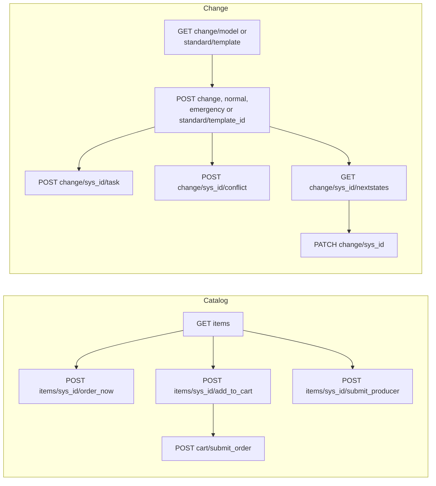

# Service Catalog and Change Management REST APIs

**In one line:** to order from the catalog or drive changes from outside, use the **process APIs** (`/api/sn_sc/servicecatalog/...` and `/api/sn_chg_rest/change/...`) rather than inserting `sc_req_item` or `change_request` rows with the Table API: they run the cart, variables, models, templates, conflict checks and state rules the way the UI does.

From the Brazil REST API reference; not tested. General REST rules: [[REST API Fundamentals]].

## Flow



**At a glance:** catalog: find the item, then order now, cart and submit, or submit a record producer; change: pick a model or template, create, add tasks and CIs, check conflicts, move through the next allowed states.

## Service Catalog API (`/api/sn_sc/servicecatalog`)

| Method | Path | What it does |
|---|---|---|
| GET | `/catalogs`, `/catalogs/{sys_id}`, `/catalogs/{sys_id}/categories` | catalogs and categories the user can see (`sysparm_text`, `sysparm_limit`, `sysparm_offset`, `sysparm_top_level_only`, `sysparm_view`) |
| GET | `/categories/{sys_id}` | one category |
| GET | `/items`, `/items/{sys_id}` | items (`sysparm_catalog`, `sysparm_category`, `sysparm_text`, `sysparm_type`, `sysparm_view`) and one item with its variables |
| POST | `/items/{sys_id}/order_now` | order one item at once (`sysparm_quantity`, `sysparm_requested_for`, `sysparm_also_request_for`, `variables`) |
| POST | `/items/{sys_id}/add_to_cart` | add to the user's cart (same parameters) |
| GET, PUT, DELETE | `/cart`, `/cart/{cart_item_id}` | read the cart, change an item's quantity or variables, remove it |
| DELETE | `/cart/{sys_id}/empty` | empty a cart: `admin` or `catalog_admin` can empty any user's cart (the page also splits `admin` deleting the cart from `catalog_admin` deleting its items) |
| POST | `/cart/checkout`, `/cart/submit_order` | check out: one-step returns `request_number` and `request_id`; two-step returns the order status and what the second step needs |
| GET | `/cart/delivery_address/{user_id}` | shipping address |
| POST | `/items/{sys_id}/submit_producer` | run a **record producer**; returns the created record's Table API path and a redirect URL |
| POST | `/items/{sys_id}/checkout_guide`, PUT `/items/{sys_id}/submit_guide` | order guides: items for checkout, items chosen by the guide's rules |
| GET, POST | `/wishlist`, `/wishlist/{cart_item_id}`, `/items/{sys_id}/add_to_wishlist` | wish list |
| GET, POST | `/items/{item_sys_id}/delegation/{user_sys_id}`, `/items/{item_sys_id}/get_invalid_delegated_users` | whether the item can be requested for that user or those users |
| POST | `/variables/{sys_id}/display_value` | display value of a variable value (`sysparm_value`) |

- Ordering for someone else follows `glide.sc.req_for.roles` (role list) and `glide.sc.req_for.roles.default` (`allow` or `deny` when the list is empty) ([[Delegated Requests and Requests from Other Records]], [[Service Catalog Properties Reference]]).
- Path variant: the heading of the display value endpoint prints `/sn/sc/servicecatalog/variables/{sys_id}/display_value`, while its URL lines and example use `/api/sn_sc/servicecatalog/...`. Both kept; the URL lines match the rest of the API.

## Change Management API (`/api/sn_chg_rest/change`)

Roles: **GET** `change_manager`, `itil`, `sn_change_read` or `admin`; **POST, PATCH** `change_manager`, `itil` or `admin`; **DELETE** `change_manager` or `admin`. The CI schedule endpoint (GET `/change/ci/{cmdb_ci_sys_id}/schedule`) names `sn_change_writer` instead. Behaviour is also shaped by the Change Management properties ([[Change Management Plugins, Tables and Workspace Configuration]]).

| Method | Path | What it does |
|---|---|---|
| GET, POST | `/change` | list (`sysparm_query`, `textSearch`, `order`, `sysparm_offset`) or create from a **change model** (`chg_model`, `type`, `encrypted_fields`) |
| GET, POST, PATCH, DELETE | `/change/normal[/{sys_id}]`, `/change/emergency[/{sys_id}]` | type-specific list, create from the default record, read, update, delete |
| GET, PATCH, DELETE | `/change/standard[/{sys_id}]`; POST `/change/standard/{standard_change_template_id}` | standard changes, created from a published template |
| GET | `/change/standard/template[/{sys_id}]`, `/change/model[/{sys_id}]` | templates and models available |
| GET, PATCH, DELETE | `/change/{sys_id}` | any change regardless of type |
| GET | `/change/{change_sys_id}/nextstates` | states the change can move to next |
| GET, POST, PATCH, DELETE | `/change/{change_sys_id}/task[/{task_sys_id}]` | change tasks (`change_task`) |
| GET, POST | `/change/{sys_id}/ci` | CIs linked to the change, by `association_type` (`affected` CIs, impacted services, impacted service `offering`s) |
| POST | `/change/{sys_id}/refresh_impacted_services` | recompute impacted services from the CIs |
| GET, POST, DELETE | `/change/{sys_id}/conflict` | conflict check status, start, cancel ([[Change Conflict Detection and Maintenance Schedules]]) |
| GET | `/change/{change_sys_id}/schedule`, `/change/ci/{cmdb_ci_sys_id}/schedule`; PATCH `/change/{change_sys_id}/schedule/first_available` (`duration_in_seconds`, `planned_start_time`) | free time slots; asynchronous, poll the `worker.link` in the response |
| GET | `/change/worker/{sys_id}` | status and errors of an asynchronous worker |
| PATCH | `/change/{sys_id}/approvals` | the current user approves or rejects (`state`, `comments`) |
| PATCH | `/change/standard/{sys_id}/risk` | calculate risk and impact (cumulative with Change Risk Assessment when installed; [[Change Risk Calculation and Assessment]]) |

Create from a model: list models with GET `/change/model`, then POST `/change` with `chg_model` ([[Change Models and Change Templates]]).

## Example

Order *Example Laptop* for *Test User*:

```bash
curl -X POST -u "<USER>:<PASSWORD>" -H "Content-Type: application/json" "https://<instance>.service-now.com/api/sn_sc/servicecatalog/items/<ITEM_SYS_ID>/order_now" -d '{"sysparm_quantity":"1","sysparm_requested_for":"<TEST_USER_SYS_ID>","variables":{"example_variable":"example value"}}'
```

Create a standard change from *Example Standard Template*:

```bash
curl -X POST -u "<USER>:<PASSWORD>" -H "Content-Type: application/json" "https://<instance>.service-now.com/api/sn_chg_rest/change/standard/<TEMPLATE_SYS_ID>" -d '{"short_description":"Example standard change","cmdb_ci":"<CI_SYS_ID>"}'
```

## Related

- [[REST API Fundamentals]] · [[Request Management Data Model and Process]] · [[Cart, Checkout and Cart Layouts]] · [[Record Producers]] · [[Order Guides]] · [[Service Catalog Scripting APIs (CartJS, CatItem, UserCriteria, g_service_catalog)]] · [[Change Management Overview and Lifecycle]] · [[Standard Change Catalog]] · [[change_request]] · [[Core Platform REST APIs - Table, Attachment, Aggregate, Batch, Import Set and Others]]
