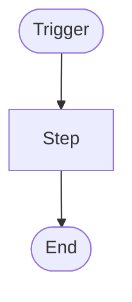

# Exercise: <Short Generic Name>

Author: <FirstName>. Instance: <label from `_meta/Instances.md`, e.g. pdi-1 (PDI) or client-A (client), never the real instance name>, <date>.

## Brief

<The task as given, without client names.>

## Pattern

<One line naming the reusable shape, e.g. "date-driven reminder: log one ticket per record when a date gets close". Use the same wording as other exercises with the same shape, and list it in `09-Exercises/_index.md`.>

## Flow

<Only when the solution is a flow (flow, workflow, approval, several record types); delete otherwise. Conventions: `_meta/Procedures/Diagrams.md`. Screenshots: embed the files from the documentation notes (`_meta/Procedures/Screenshots.md`).>

## Solution map

| Requirement | Approach | Note |
|---|---|---|
| | | |

## Options considered

<Every route weighed, including the rejected ones, so the next similar ask starts from the comparison. When two options both work, create or extend an `08-Approaches/` note and link it ([[Improvement Loop]]).>

| Option | Verdict | Why | Evidence |
|---|---|---|---|
| | chosen / rejected / fallback | | docs / observed / verified / inference |

## Open with the requester

<Anything the requester must confirm: unclear criteria, values the brief doesn't give, assumptions made to keep building. Repeat this list, current, at the end of every reply while the exercise is open. Strike items off with the answer.>

## Gaps

- <Parts no note covered, and what would fill them.>

## To undo after testing

<Every test-only change made in the instance (system properties, shortened schedules or SLA timers, test users, groups and records, notifications enabled), with the value to put back. Add a row the moment the change is made, repeat the list in the reply that closes the exercise, and tick rows off when undone. Changes that meet the acceptance criteria stay and are not listed. Delete the section only if nothing was changed for testing.>

| Setting or record | Where (menu path) | Test value | Put back to | Undone |
|---|---|---|---|---|
| | | | | |

## Outcome

<What was built, what differed from the plan, what the instance had, lacked or labelled differently.>

## Since written

<Dated lines added when a later docs page, release or instance finding affects this exercise, written by whoever finds it (`impact.ps1` lists the exercises to check). Format: `- <date>: <what changed> (<evidence>, link to the note). Effect here: <...>.` Delete the section while empty.>

## Reuse it for

Similar asks this build answers with small changes. Mark untested variations as such.

| Similar ask | What to change | Note |
|---|---|---|
| | | |

**Building blocks** (pieces that work on their own in other builds): <e.g. a catalog item, a business rule, an encoded query>, each linked to its note.
