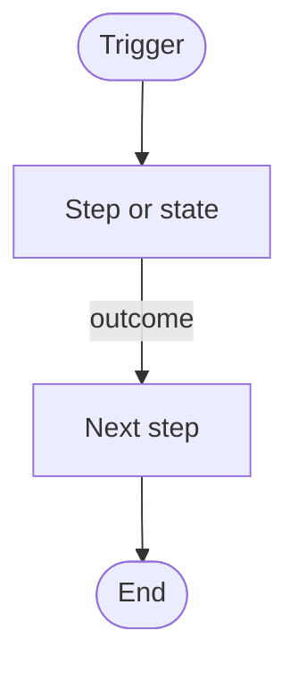

# <Task, phrased as what you want to achieve>

**Goal:** <one sentence>
**Prerequisites:** <roles, plugins, properties, data needed>
**Navigation:** <All > Application > Module, or the table.do / table.list URL>

## Flow

<Only for flows, approvals, multi-record builds; delete otherwise. Conventions: `_meta/Procedures/Diagrams.md`.>

**At a glance:** Trigger <...> · Changes <...> · Check it worked <...>

## Steps

1. 
2. 

## Result / how to check it worked

<what you should see>

## Example

<A generalised worked example with placeholder names (Example Group, Test User).>

## Tables / fields involved

- [[table_name]]: <which columns matter, as Label (`name`)>

## Other ways to do this

<Link to an `08-Approaches` note if there is more than one way. Otherwise delete this section.>

## Gotchas

- <update set capture, scope, ACLs, release differences>

## Since written

<Dated lines when a later docs page, release or instance finding affects these steps ([[Improvement Loop]]). Delete while empty.>
