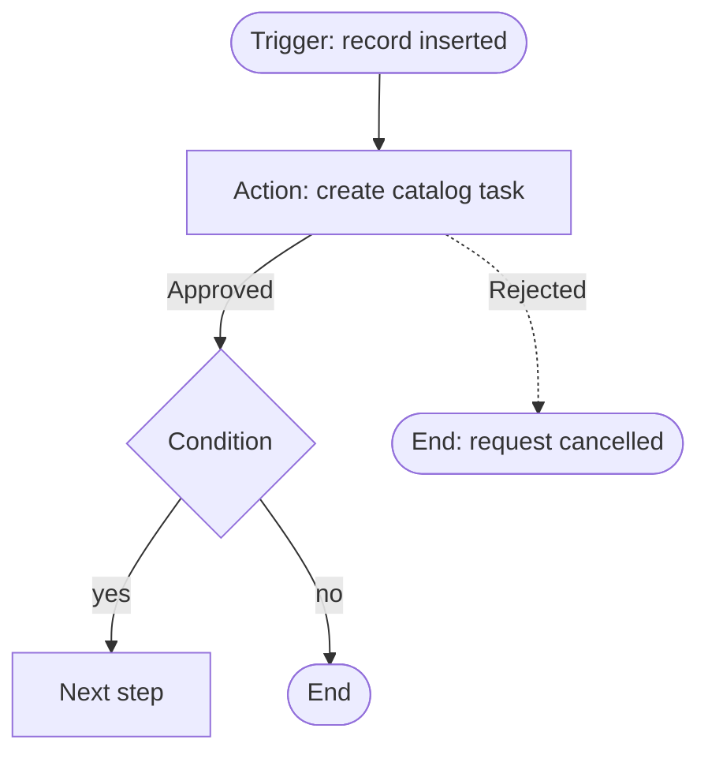

# Diagrams

Every note that describes a **flow** (a Workflow Studio flow, a classic workflow, an approval process, a multi-record build in an exercise, a verified recipe that is a flow) starts with a picture of it, so a reader understands the whole before the steps.

## Format: Mermaid

Obsidian and GitHub both draw Mermaid code blocks natively. Put the block under `## Flow`, right after the header lines.

````

````

| Shape | Mermaid | Used for |
|---|---|---|
| Stadium `([ ])` | `T([...])` | trigger and end points |
| Rectangle `[ ]` | `S[...]` | an action, step or state |
| Diamond `{ }` | `D{...}` | a condition, loop or approval outcome |
| Solid arrow with label | `-->|label|` | the normal path |
| Dotted arrow | `-.->` | failure or rarely used paths |

- One box per flow action or workflow activity; arrows labelled with the outcome. Several tables or flows: `subgraph` blocks.
- Placeholders only: no client names, real sys_ids or URLs.
- `TD` for most flows, `LR` for short linear ones.

## At a glance

Under the diagram, a small table or line answers what a reader asks first: what triggers it, on which table, what changes, how to check it worked.
