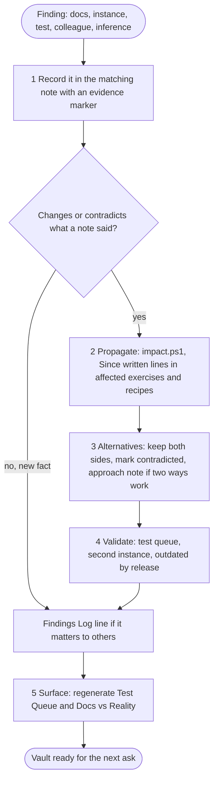

# Improvement loop

Read whenever something new is learned, from any source and at any moment: a docs page or release note, a screen in an instance, a test that passed or failed, a colleague, or Claude's own reasoning. The vault gets better only if each finding is **recorded with its evidence, carried to everything that depends on it, kept next to its alternatives, validated, and made visible**. This happens **during** the work, mid-exercise included, not only at the end.

## Flow

**At a glance:** Trigger: anything learned · Changes: the note, every exercise and recipe that relies on it, the Findings Log, the generated pages · Check it worked: `impact.ps1` lists nothing unchecked; the finding shows in [[Findings Log]] and, when it disagrees with the docs, in [[Docs vs Reality]]

## 1. Record with evidence

`status` is the note's headline. Inside the note, **each claim that is not plain docs carries a short marker**, so mixed notes keep their tested parts:

| Marker | Means |
|---|---|
| `(verified <instance> <date>)` | tested end to end by a contributor in that instance |
| `(observed <instance> <date>)` | seen on screen, not tested end to end |
| `(docs <page title or release>)` | from a ServiceNow docs page, API reference or release notes, untested; only needed where a note mixes sources |
| `(colleague <date>)`, `(team notes <date>)`, `(community <date>)` | from a person or forum; treated as `unverified` |
| `(inference)` | Claude's or a contributor's reasoning, not seen anywhere; must be settled later |
| `(contradicted: <by what, where, when>)` | another source or instance disagrees; the other side is written next to it |
| `(outdated from <release>: <what changed>)` | true for older releases only; the newer behaviour is written next to it |

The instance label also goes into the note's `observed-in:` list. A finding from an exercise goes into the matching documentation note (`documented` notes included) **and** the exercise, at the moment it is made.

Older notes written before 2026-11-06 use the phrase *unconfirmed variants* instead of markers. Both are read by the tools; new text uses markers.

## 2. Propagate

When a finding **changes, corrects or contradicts** something a note said, or adds an option to it:

1. Run `powershell -ExecutionPolicy Bypass -File _meta/tools/impact.ps1 -Note "<note>|<other note>"`. After a batch of edits, use `-Range "<first commit>~1..HEAD"`.
2. Read every **exercise** and **recipe** it lists. For each one the finding affects, add a dated line to its `## Since written` section (create it just before `## Reuse it for` in exercises, before `## Related` elsewhere):
   `- 2026-11-06: <what changed> (<evidence>, link to the note). Effect here: <what to do differently, or "none for this build">.`
3. Do not rewrite another author's exercise or a `verified` step: add the *Since written* line, and mark the old claim `(contradicted: ...)` or `(outdated from ...)` instead of deleting it.
4. How-tos and other notes listed: fix the ones that repeat the changed fact.

It works both ways: docs to exercises (a page or release changes what an exercise built) and exercises to docs (an instance shows the docs or an earlier exercise were wrong).

## 3. Keep the alternatives

- A contradiction keeps **both sides** with their evidence and goes into the test queue until a test settles it. The settled side becomes the claim; the other stays as `(contradicted ...)` or moves to Gotchas.
- Exercises record **Options considered** (option, verdict, why, evidence), rejected ones included. When two options both work, create or extend an `08-Approaches/` note and link it from both how-tos.
- A failed attempt is a finding too: symptom, cause, fix in `07-Troubleshooting/` or the note's Gotchas, linked from the exercise.

## 4. Validate

Evidence grows in steps: `(inference)` / `(docs)` -> `(observed)` -> `(verified)` in one instance -> verified in **two instances** (two labels in `observed-in:`). [[Test Queue]] lists the open questions, unconfirmed and inferred claims, contradictions, verified notes seen in only one instance, and notes written for a release newer than any recorded instance.

**Retiring by release:** when a newer release family changes behaviour, mark the old claim `(outdated from <release>: ...)` and write the new behaviour next to it; older instances still need the old one. Set a whole note to `status: outdated` only when nothing in it applies any more, with a link to its replacement. Record the instance's release in [[Instances]] first.

## 5. Surface

- **[[Findings Log]]:** one dated line per finding that changed, corrected or contradicted a note, or that other contributors should know. New facts that only fill a gap don't need a line.
- **[[Docs vs Reality]]** (`docs-vs-reality.ps1`): every contradicted or outdated claim, every place an instance behaved differently from the docs, every disagreement between sources.
- **[[Test Queue]]** (`test-queue.ps1`).

Regenerate both pages after a batch of findings and before committing.

## Triggers

| When this happens | Update |
|---|---|
| An instance shows a screen, default, label or behaviour no note holds | the matching note (marker `observed`, `observed-in:`), the exercise |
| A finding contradicts a note or an earlier exercise | both sides with markers, `impact.ps1`, *Since written* lines, Findings Log, approach note if both ways work |
| A test passes | `verified` marker or status, `verified-by`, `observed-in`; a verified exercise gets its recipe or how-to |
| A step fails | troubleshooting note or Gotchas; the exercise's Options considered; Findings Log if a note said it would work |
| An instance turns out to run another release | [[Instances]]; check the exercise against the `sn-release` of the notes it relies on |
| A docs page, API reference or release notes are read | merged notes, then `impact.ps1 -Range` on the batch; *Since written* lines |
| Claude reasons something it has not seen | marker `(inference)`; it shows in the test queue |
| A colleague, the team or a forum says something | the note with `(colleague ...)` or `(team notes ...)`; `unverified` until tested |

## End of a session

Before the final reply, list what the session learned and where each item went (note, exercise, Findings Log). Anything without a home gets one, or goes into the test queue as an open question. Then regenerate the two pages and run the audit.

## Related

- [[CLAUDE]] · [[Recording Results and Inbox]] · [[Stories and Exercises]] · [[Ingesting ServiceNow Docs]] · [[Guiding Work in an Instance]]
